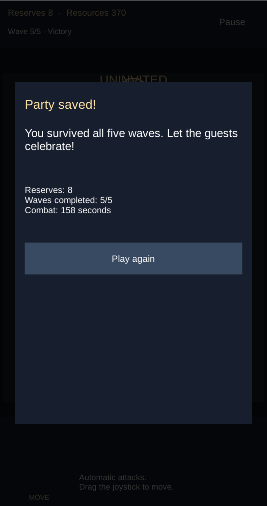

# Web verification in Chrome

## Pixel 10 hardware: October 10, 2026

Connected **Google Pixel 10**, **Android 16**, **Chrome 154.0.8037.126**. Unity 6000.3.5f2 IL2CPP Web build: **17,232,614 bytes**. The browser ran on the physical phone; taps and drags were injected with Android SDK ADB over USB. These are real-device single-pointer checks, not finger usability or simultaneous physical multitouch tests.

The Mac served `Builds/Web` locally. `adb reverse tcp:8081 tcp:8081` made `http://127.0.0.1:8081/` available on the phone without publishing the game. A fresh port was used for the corrected build after the previous browser session still exhibited the old behavior; every build asset returned HTTP 200 on the fresh origin. The served WASM SHA-256 matched the compiled artifact: `c9ed5669441ff4b1353004b783d6f8fbb4e4e630e34ff8c4ece5bd4ed0d26eb2`.

The first hardware run reproduced a joystick error: a left drag moved the guardian up and right. `ScreenPointToLocalPointInRectangle` returns pivot-relative coordinates; the HUD uses a bottom-left pivot, so those coordinates must be offset by `rect.rect.center`. Earlier constructed pointer tests used the pivot as their test origin and missed the visible-center problem. The regression tests now originate at the visible center and check neutral input and all four cardinal directions at three canvas scales. **102 Play Mode checks passed**, and the corrected Web build was retested on the phone.

| Check on corrected build | Observed result |
| --- | --- |
| English menu and portrait layout, 1080 × 2424 device screenshot | Text, six slots, base, pause, joystick and preparation controls visible below Chrome's toolbar and above Android's gesture bar |
| Left/right/up/down drags, then release | Guardian moves in the corresponding direction; joystick knob returns to center |
| Approximately centered hold | No substantial guardian movement; exact neutral coordinates are covered separately by Play Mode checks |
| Slot 3 → Pumpkin → confirm | Resources change from 100 to 50 once; one defense appears at slot 3 |
| Start wave and rotate during combat | Enemies continue along the path; whole board, pause and joystick remain visible; landscape rotation hint remains present |
| Background Chrome and return | Explicit pause dialog appears and remains until Resume is pressed |
| Resume after first-wave completion | Preparation for wave 2, 13 reserves and 97 resources in the one-defense smoke run |
| Restart from pause | Preparation for wave 1, 20 reserves and 100 resources; purchased defense disappears and guardian returns to its initial position |
| Landscape → portrait | Full portrait board and controls return without reload |

Orientation was changed through Android's display rotation command, not by physically turning the phone. The original automatic-rotation setting was restored afterward. Chrome's address bar stayed visible in this run; dynamic bar collapse/expansion and other cutout shapes remain pending. After rotation/backgrounding while paused, the board backdrop could be black until Resume; the pause dialog remained usable and resuming restored rendering.

No frame-rate, memory or thermal benchmark was recorded. A successful hardware run does not certify all Android browsers, iOS, or manual finger ergonomics.

Hardware screenshots, cropped to the game area: [portrait preparation](Screenshots/pixel10-portrait.png) and [landscape combat](Screenshots/pixel10-landscape.png).

### Full-match hardware run

A separate match started from the reset state. The guardian was moved with the corrected joystick to the central bend and remained there during combat. All purchases and upgrades used the visible UI; no debug methods, balance changes or time acceleration were used.

| Before wave | Preparation actions | Reserves / resources after preparation |
| --- | --- | --- |
| 1 | Build Pumpkins at slots 3 and 4; move guardian to the central bend | 20 / 0 |
| 2 | Build Speaker at slot 5 | 20 / 16 |
| 3 | Build Web at slot 1; upgrade Pumpkin at slot 3; build Pumpkin at slot 6 | 20 / 0 |
| 4 | Upgrade Pumpkins at slots 4 and 6 | 11 / 25 |
| 5 | Upgrade Web and Speaker; build and upgrade Pumpkin at slot 2 | 8 / 34 |

**Result: victory, 5/5 waves, 8 reserves remaining, 370 resources, 158 seconds of combat reported by the game.** The same build ran the entire match in Chrome on the phone. The guardian stayed at the central bend after preparation; strategy and preparation time differ from the simulation run. The target 4–6 minute human session duration was not timed in this automated run.

Pressing **Play again** after victory restored preparation for wave 1 with 20 reserves, 100 resources, six empty slots and the guardian at its initial position.

## Human finger and multitouch follow-up: October 10, 2026

A person subsequently played the same merged PR #3 build on the Pixel 10 using their own fingers and reported that the controls felt comfortable. Synchronized touchscreen traces captured **two simultaneous physical contacts**, with screen video and tester feedback supporting joystick owner-release cancellation, construction dialog cancellation, and pause/resume cancellation while the original finger remained down. No automated input was sent during the captures and no gameplay or build changes were made.

See [the physical touch report](TouchVerification.md) for per-case results, contact-transition CSV files, game-only frames and limitations. The tester also reported that releasing the second finger preserved the owner's control, but a matching release-order sequence was not independently captured. An isolated four-direction/small-motion finger sequence remains uncorroborated. These results do not certify ergonomics across people, devices or orientations.

## English UI and mobile layout: October 10, 2026

Unity 6000.3.5f2 IL2CPP Web build: **17,232,559 bytes**. Served locally over HTTP from `Builds/Web` and inspected in desktop Chrome on the development Mac. Mobile cases below use Chrome DevTools emulation, not physical phones or Safari.

| Viewport/profile | Checks performed | Observed result |
| --- | --- | --- |
| Wide desktop window | English menu, opening the party, board layout | Menu instructions and buttons render in English; the whole board is centered between separate HUD/control bars |
| Responsive, 320 × 568 | Menu, slot selection, defense descriptions, purchase confirmation, joystick | English text fits; selecting slot 3 and buying a Pumpkin changes resources from 100 to 50 once; held joystick input moves the guardian and the knob recenters on release |
| Responsive, rotated to 568 × 320 | Board visibility, starting a wave, pause and restart dialogs | Whole board remains visible; controls use shorter bars; the rotation suggestion remains visible after starting a wave; enemies spawn; pause/restart buttons remain accessible |
| Chrome iPhone SE profile, 375 × 667, device pixel ratio 2 | Reload with density 2 active; canvas dimensions; menu layout | The console reports 375 CSS pixels and 750 render pixels for canvas width. English menu paragraphs and buttons remain visible at a readable layout size |

The profile's advertised touch capability was one touch point. This checks single-pointer emulation only. A real iPhone was not used. Higher canvas density was applied by reloading after choosing the profile; changing a profile without reloading retains the render pixel ratio chosen at startup.

During the rotated responsive run, the rotation suggestion persisted from preparation into combat. The pause dialog rendered in English and the restart action restored the initial 100 resources. Constructed Play Mode events separately check joystick cancellation on pause and opening a modal, second-pointer ownership, and presses on controls blocking board selection; see `RuntimeVerification.md`.

Chrome's console showed **No errors** in the inspection performed, alongside WebGL `INVALID_ENUM: getInternalformatParameter` and callback duration warnings. This is an inspection result rather than a guarantee about every subsequent frame or device.

Changing dimensions through the DevTools toolbar temporarily cleared the canvas while focus was outside the game. Clicking the canvas restored rendering at the new dimensions without a page reload. Real mobile rotation and browser-bar focus behavior still need device testing.

## Earlier prototype checks (PR #1)

The original 17,204,494-byte build was also checked in desktop Chrome on this Mac:

- Full board, six construction slots, guardian, reserves, and controls visible in a wide window.
- D moves the guardian to the right.
- Opening the browser console pauses the game; closing it leaves the game paused until explicit resumption.
- With no defenses and the guardian away from the path, the first wave reduces reserves from 20 to 12, ends in preparation, and awards the 40-resource bonus.
- Wave two includes common circles and runner triangles. The match ends in defeat with zero reserves, one completed wave, and 53 seconds of combat.
- Replay restores preparation with 20 reserves and 100 resources, no enemies or defenses, and the guardian at its initial position.
- Selecting slot 3, choosing a Pumpkin, and confirming the purchase installs the defense and deducts 50 exactly once.

### Brief clicks and native automation

A temporary DOM event indicator and Unity component reported `Input.mousePosition`, press/release events, and the first `EventSystem.RaycastAll` hit. Both were removed after diagnosis.

The native automation `click` moved the visible cursor and sent `mousedown`/`mouseup` without `mousemove`. Chrome received the click coordinates, but Unity still used an earlier mouse position, initially `(0, 0)`. The raycast hit the modal background instead of the intended button. A gesture emitting `mousemove` updated Unity's position. This explains the automation inconsistency; it does not establish a physical mouse failure.

With the position updated, clicks without dragging during the click produced these results. Durations were measured between DOM events rather than assumed from the requested tool delay.

| Action | Measured duration | Observed result |
| --- | --- | --- |
| Restart from pause | 48 ms | Preparation with 20 reserves and 100 resources; raycast identifies the restart button |
| Select slot 3 | 51 ms | Opens the slot panel with 100 resources |
| Restart from pause again | 97 ms | Restores initial values; raycast identifies the restart button |

These samples cover restart and board selection, not every button at every duration. The current-position UI raycast added in the English delivery addresses stale UI hit state; it does not synthesize a missing mouse movement event for native automation.

## Pending checks

Physical mouse usability, broader finger usability, independently capturing the remaining finger sequences listed in the touch report, dynamic mobile browser bars, other safe-area/cutout shapes, human session timing, sustained phone performance, and other browsers/devices. The complete five-wave Web victory was observed on Pixel 10; that full-match result remains limited to the tested Chrome version and ADB input. The subsequent human touch session, responsive emulation and constructed pointer events have separate scopes.
